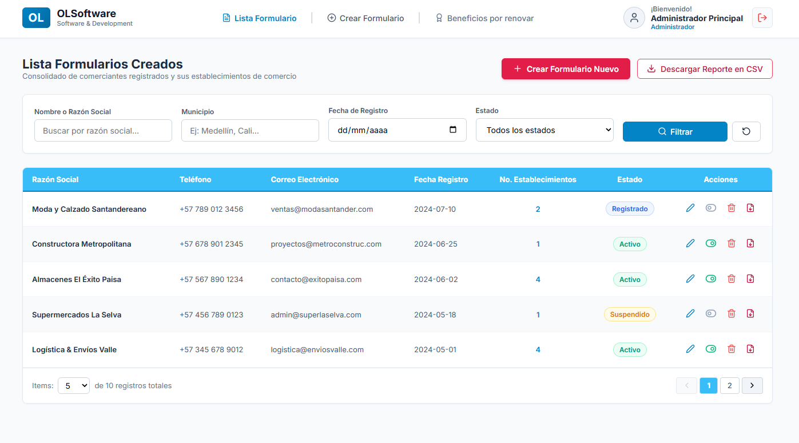
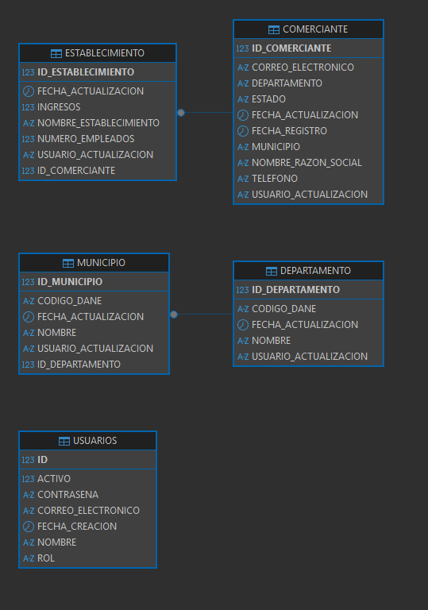

# Prueba Técnica Integral Fullstack (PL/SQL - Java Spring Boot - React)
## Agremiación Nacional de Comercio | OL Software



Solución completa y profesional desarrollada para la prueba técnica integral fullstack, estructurada rigurosamente en sus tres fases correspondientes:

1. **`database/`** - Evaluación PL/SQL Fullstack (Oracle 11gR2 / 23ai Free)
2. **`backend/`** - Evaluación Spring Boot Fullstack (Java 21, Arquitectura Limpia, SOLID, JWT, OpenPDF, Docker)
3. **`frontend/`** - Evaluación React Fullstack (React 19, TypeScript, Vite, OWASP, Estado Global)

---

## 📊 Matriz de Cumplimiento de Retos

| Reto / Componente | Descripción | Estado |
|---|---|:---:|
| **Reglas Generales** | Oracle 11gR2+, Java 21, React 19, Clean Architecture, OWASP TOP 10 | ✅ Cumplido |
| **Reto 01** | Modelo de Datos relacional, normalización, auditoría y MER | ✅ Cumplido |
| **Reto 02** | Secuencias de BD, triggers `BEFORE INSERT` y triggers de auditoría | ✅ Cumplido |
| **Reto 03** | Datos semilla aleatorios (10 comerciantes y 30 establecimientos) | ✅ Cumplido |
| **Reto 04** | Paquete PL/SQL `PKG_COMERCIANTES` (CRUD, cursores explícitos, validaciones) | ✅ Cumplido |
| **Reto 05** | Función PL/SQL de Reporte con `SYS_REFCURSOR` y totales calculados | ✅ Cumplido |
| **Reto 06** | Web API: Seguridad con JWT (1 hora), RBAC y política CORS | ✅ Cumplido |
| **Reto 07** | Web API: Listas de valores con caché en memoria (`@Cacheable`) | ✅ Cumplido |
| **Reto 08** | Web API: CRUD Comerciante (paginación, filtros, PATCH estado, PL/SQL) | ✅ Cumplido |
| **Reto 09** | Web API: CRUD Establecimiento con validaciones y ORM JPA | ✅ Cumplido |
| **Reto 10** | Web API: Descarga de Reporte CSV delimitado por pipe (`\|`) (Admin) | ✅ Cumplido |
| **Reto 11** | Web API: Ficha de Comerciante en PDF con OpenPDF (Admin) | ✅ Cumplido |
| **Reto 12** | React: Página de Login (OWASP, validación términos, JWT ofuscado) | ✅ Cumplido |
| **Reto 13** | React: Página Home (tabla, paginado, filtros, acciones por rol, CSV/PDF) | ✅ Cumplido |
| **Reto 14** | React: Formulario dinámico con establecimientos y footer en tiempo real | ✅ Cumplido |
| **Pruebas Unitarias** | Mínimo 3 requeridas: 10 en Backend (JUnit 5) + 6 en Frontend (Vitest) | ✅ Cumplido |
| **Compilado Distribución** | Archivo comprimido `frontend-dist.zip` para producción | ✅ Cumplido |
| **Entrega Final** | Envío de ruta de repositorio público al correo de la prueba | ⏳ Pendiente |

---

## ✅ Checklist de Objetivos de la Prueba Técnica

### 1. Fase Base de Datos: PL/SQL

#### Reglas Generales de Base de Datos
- [x] Utilizar Oracle 11gR2 o superior (compatible con Oracle 23ai Free en contenedor).
- [x] Definir los índices que considere necesarios (índices funcionales `UPPER`, índices en filtros `FECHA_REGISTRO`, `ESTADO`).
- [x] **Cero cursores implícitos**: todos los cursores implementados son explícitos y parametrizados.
- [x] Todos los procedimientos, funciones, records y tipos PL/SQL contenidos dentro de un paquete de base de datos (`PKG_COMERCIANTES`).
- [x] Sentencias DML y DDL consignadas en archivos `.sql` organizados y numerados secuencialmente.
- [x] Script maestro `00_run_all.sql` para replicación desatendida en ambientes de calificación.

#### RETO 01: Modelo de Datos
- [x] Diseñar modelo de datos para la entidad `COMERCIANTE`: Nombre/Razón Social, Departamento, Municipio, Teléfono, Correo Electrónico, Fecha de Registro y Estado (`Registrado`, `Activo`, `Inactivo`, `Suspendido`, `Cancelado`).
- [x] Diseñar modelo de datos para la entidad `ESTABLECIMIENTO`: Nombre del Establecimiento, Ingresos (`NUMBER(14,2)` con 2 decimales) y Número de Empleados (`NUMBER(6)`).
- [x] Normalización del modelo: entidades maestras `DEPARTAMENTO` y `MUNICIPIO` con integridad referencial (`ON DELETE CASCADE` en establecimientos).
- [x] Campos de auditoría incluidos en las entidades: `FECHA_ACTUALIZACION`, `USUARIO_ACTUALIZACION` (y fechas de registro).
- [x] Modelo Entidad-Relación (MER): Documentado en `database/06_mer_diagram.md` con diagrama Mermaid, diccionario de datos y justificación 1FN, 2FN y 3FN.

#### RETO 02: Secuencias, Identificadores y Auditoría
- [x] Identificador único generado por secuencias de base de datos (`SEQ_COMERCIANTE`, `SEQ_ESTABLECIMIENTO`, `SEQ_DEPARTAMENTO`, `SEQ_MUNICIPIO`).
- [x] Cada secuencia gestionada por triggers `BEFORE INSERT` (`TRG_COMERCIANTE_BI`, `TRG_ESTABLECIMIENTO_BI`).
- [x] Campos de auditoría actualizados automáticamente mediante triggers en inserción y actualización (`TRG_COMERCIANTE_BU`, `TRG_ESTABLECIMIENTO_BU`).

#### RETO 03: Datos Semilla
- [x] Generar datos semilla para `COMERCIANTE`: exactamente 10 registros aleatorios y con datos no repetitivos.
- [x] Generar datos semilla para `ESTABLECIMIENTO`: exactamente 30 registros aleatorios distribuidos entre los comerciantes.
- [x] Cantidad de establecimientos por comerciante asignada de forma aleatoria.
- [x] Inclusión de departamentos y municipios de Colombia como catálogo precargado (`database/03_seed_data.sql`).

#### RETO 04: Paquete de Primer Nivel (`PKG_COMERCIANTES`)
- [x] **Función `FN_CONSULTAR_POR_ID`**: Retorna cursor/registro con Nombre/Razón Social, Departamento, Municipio, Teléfono, Correo, Fecha de Registro, Estado, y los campos calculados **Total Activos** (sumatoria de Ingresos) y **Cantidad de Empleados** (sumatoria de empleados de establecimientos asociados).
- [x] **Función `FN_CONSULTAR_COMERCIANTES`**: Consulta con paginación (offset / limit) y filtros parametrizados por:
  - Nombre o Razón Social
  - Municipio
  - Fecha de Registro
  - Estado
- [x] **Procedimientos DML**:
  - `PR_CREAR_COMERCIANTE`
  - `PR_ACTUALIZAR_COMERCIANTE`
  - `PR_CAMBIAR_ESTADO_COMERCIANTE`
  - `PR_ELIMINAR_COMERCIANTE`
- [x] Campos de entrada solicitados en creación/actualización: Nombre/Razón Social, Departamento, Municipio, Teléfono (Opcional), Correo (Opcional), Fecha de Registro y Estado.
- [x] Validaciones de entrada: tipos de datos, obligatoriedad, formato de correo con expresión regular RFC.
- [x] Parámetros de salida obligatorios: `P_CODIGO_ERROR` (0 en éxito, no cero en error) y `P_MENSAJE_ERROR` (nulo en éxito, texto capturado en bloque de excepciones).
- [x] Funciones auxiliares (`FN_VALIDAR_EMAIL`, etc.).

#### RETO 05: Reporte de Comerciantes
- [x] Función `FN_REPORTE_COMERCIANTES_ACTIVOS` que retorna cursor referenciado (`SYS_REFCURSOR`).
- [x] Filtro estricto por comerciantes registrados y activos (`ESTADO IN ('Registrado', 'Activo')`).
- [x] Estructura requerida: Nombre, Departamento, Municipio, Teléfono, Correo, Fecha Registro, Estado, Cantidad de Establecimientos, Total Activos y Cantidad de Empleados.
- [x] Campos calculados en tiempo real sumando los valores de los establecimientos asociados.
- [x] Ordenamiento descendente por la cantidad de establecimientos asociados (`ORDER BY CANTIDAD_ESTABLECIMIENTOS DESC`).

---

### 2. Fase Backend: Spring Boot

#### Reglas Generales de Backend
- [x] Utilizar Java 11 o superior (implementado con **Java 21 LTS**).
- [x] Framework **Spring Boot** (versión 3.3.5).
- [x] Mínimo 3 pruebas unitarias con JUnit (implementadas **10 pruebas unitarias** con JUnit 5 y Mockito).
- [x] Documentación de APIs con Swagger UI (`/swagger-ui.html`) y colección de Postman (`backend/postman_collection.json`).
- [x] Arquitectura limpia y principios SOLID (capas claras de Controller, Service, Repository, DTO, Mapper, Exception Handling).
- [x] Construcción de `Dockerfile` para despliegue contenerizado independiente y con Docker Compose.

#### RETO 06: Web API - Seguridad
- [x] Endpoint público de autenticación: `POST /api/v1/auth/login`.
- [x] Recepción de credenciales en cuerpo: `correoElectronico` y `contrasena`.
- [x] Emisión de token JWT con tiempo de expiración exacto de **1 hora** (3600 segundos).
- [x] Autorización basada en roles (`ADMINISTRADOR` y `AUXILIAR_REGISTRO`) para control fino de acceso a cada endpoint.
- [x] Endpoint de login público sin requerir token JWT.
- [x] Configuración de política CORS para permitir consumo seguro y controlado desde el cliente frontend.

#### RETO 07: Web API - Listas de Valores
- [x] Endpoints para listas de valores:
  - `GET /api/v1/catalogos/departamentos`: Lista de departamentos.
  - `GET /api/v1/catalogos/departamentos/{id}/municipios`: Municipios asociados al departamento.
- [x] Caché en memoria implementado con Spring Cache (`@Cacheable("departamentos")`, `@Cacheable("municipios")`) para evitar consultas redundantes a la base de datos.
- [x] Mapeo con ORM Spring Boot JPA / Hibernate.
- [x] Endpoints privados protegidos con JWT.
- [x] Estandarización de respuestas HTTP (`ApiResponse<T>`).

#### RETO 08: Web API - CRUD Comerciante
- [x] Endpoint de consulta paginada `GET /api/v1/comerciantes` con valor por defecto de 5 registros por página.
- [x] Filtros reactivos por: Nombre o Razón Social, Municipio, Fecha de Registro y Estado.
- [x] Endpoint de consulta por ID `GET /api/v1/comerciantes/{id}` con campos calculados (Total Activos y Cantidad de Empleados).
- [x] Endpoint de creación `POST /api/v1/comerciantes`.
- [x] Endpoint de actualización `PUT /api/v1/comerciantes/{id}`.
- [x] Endpoint de eliminación `DELETE /api/v1/comerciantes/{id}` (restringido a Administrador).
- [x] Consumo / compatibilidad con los procedimientos y funciones del Reto 04.
- [x] Endpoint para modificar estado (Activar / Inactivar) utilizando el método HTTP **PATCH**: `PATCH /api/v1/comerciantes/{id}/estado`.
- [x] Validaciones de entrada (Jakarta Validation: `@NotBlank`, `@Email`, obligatoriedad).
- [x] Endpoints privados con JWT y respuestas estandarizadas.

#### RETO 09: Web API - CRUD Establecimiento
- [x] Endpoint de consulta por comerciante: `GET /api/v1/establecimientos/comerciante/{comercianteId}`.
- [x] Endpoint de creación: `POST /api/v1/establecimientos`.
- [x] Endpoint de actualización: `PUT /api/v1/establecimientos/{id}`.
- [x] Endpoint de eliminación: `DELETE /api/v1/establecimientos/{id}`.
- [x] Campos solicitados: Nombre del Establecimiento, Ingresos (con decimales) y Número de Empleados.
- [x] Mapeo con ORM Spring Boot JPA / Hibernate y validaciones de datos.
- [x] Endpoints privados con JWT y respuestas estandarizadas.

#### RETO 10: Web API - Reporte Comerciantes en CSV
- [x] Endpoint para generar archivo plano: `GET /api/v1/reportes/comerciantes/csv`.
- [x] Filtro exclusivo para comerciantes registrados y activos.
- [x] Estructura requerida: Nombre, Departamento, Municipio, Teléfono, Correo, Fecha Registro, Estado, Cantidad Establecimientos, Total Activos y Cantidad Empleados.
- [x] Separador de columnas utilizando el carácter **pipe (`|`)**.
- [x] Consumo / compatibilidad con la función del Reto 05.
- [x] Acceso privado con JWT restringido exclusivamente al rol **Administrador** (`@PreAuthorize("hasRole('ADMINISTRADOR')")`).
- [x] Headers HTTP correctos para descarga de archivo adjunto (`Content-Disposition: attachment; filename=...`).

#### RETO 11: Web API - Ficha del Comerciante en PDF
- [x] Endpoint para generar archivo PDF: `GET /api/v1/reportes/comerciantes/{id}/pdf`.
- [x] Parámetro de entrada: identificador del comerciante.
- [x] Información detallada del comerciante con sumatoria agregada de establecimientos, ingresos y empleados.
- [x] Mapeo con Spring Boot JPA y generación estilizada con OpenPDF.
- [x] Acceso privado con JWT restringido exclusivamente al rol **Administrador**.
- [x] Headers HTTP correctos para visualización / descarga del documento PDF.

---

### 3. Fase Frontend: React

#### Reglas Generales de Frontend
- [x] Utilizar React 18 o superior (implementado en **React 19** con TypeScript y Vite).
- [x] Sistema de gestión para el estado global (`AuthContext` para sesión/roles, `ToastContext` para notificaciones en pantalla).
- [x] Mínimo 3 pruebas unitarias (implementadas **6 pruebas unitarias** con Vitest y Testing Library).
- [x] Recomendaciones **OWASP TOP 10**:
  - Almacenamiento seguro de tokens y credenciales en `sessionStorage` (sin exposición en `localStorage` o `window`).
  - Ofuscación de credenciales antes del envío en red para prevenir capturas en debug de navegadores.
  - Sanitización y prevención contra ataques XSS y CSRF.
  - Rutas privadas protegidas con guardias (`ProtectedRoute.tsx`).
- [x] Compilado para producción comprimido entregado en el repositorio: **`frontend/frontend-dist.zip`**.

#### RETO 12: Página - Login
- [x] Formulario con campos obligatorios: Correo Electrónico (Usuario) y Contraseña.
- [x] Checkbox obligatorio: **"Acepto términos y condiciones"**, requerido para habilitar el botón "Iniciar sesión".
- [x] Proceso de autenticación por JWT sin exponer datos en texto plano desde el debug de red.
- [x] Consumo del endpoint público de autenticación del Reto 06.
- [x] Diseño fiel al prototipo suministrado (con accesos directos para probar credenciales de Administrador y Auxiliar).

#### RETO 13: Página - Home
- [x] Encabezado superior con visualización de: **Nombre del Usuario** y **Rol** (`Administrador` o `Auxiliar de Registro`).
- [x] Tabla de comerciantes con todas las columnas requeridas:
  - Nombre o Razón Social
  - Teléfono
  - Correo Electrónico
  - Fecha Registro
  - No. Establecimientos
  - Estado
  - Acciones
- [x] Paginador funcional con selector de cantidad de ítems por página (5, 10, 20).
- [x] Botones en columna de acciones:
  - **Editar**: Redirige al formulario de edición con los datos precargados (Reto 14).
  - **Activar / Inactivar**: Consume el endpoint PATCH del Reto 08 para cambiar el estado.
  - **Eliminar**: Visible y ejecutable únicamente para usuarios con rol **Administrador**.
  - **Descargar PDF**: Visible y ejecutable para rol **Administrador**, consume el endpoint del Reto 11.
- [x] Botón **"Descargar Reporte en CSV"**: Consume el endpoint del Reto 10 para descargar el archivo delimitado por pipe (`|`).
- [x] Botón magenta **"Crear Formulario Nuevo"**: Redirige a la pantalla de creación del Reto 14.
- [x] Opción para cerrar sesión (`Cerrar Sesión`).
- [x] Diseño fiel al prototipo de la prueba.

#### RETO 14: Página - Formulario (Creación y Actualización)
- [x] Datos Generales con los campos requeridos:
  - Nombre o Razón Social *(Obligatorio)*
  - Departamento *(Obligatorio, selector alimentado por la API de catálogos)*
  - Municipio o Ciudad *(Obligatorio, selector filtrado dinámicamente según el departamento elegido)*
  - Teléfono
  - Correo Electrónico
  - Fecha de Registro *(Obligatorio, selector de fecha)*
  - Checkbox **"¿Posee establecimientos?"**
- [x] **Sección condicional "Gestionar Establecimiento"**:
  - Se despliega dinámicamente solo si el checkbox "¿Posee establecimientos?" está marcado.
  - Permite crear, listar, editar y eliminar múltiples establecimientos en tarjetas.
  - Modal interactivo para creación y edición de establecimiento.
  - Campos obligatorios de establecimiento: Nombre del Establecimiento, Ingresos y Número de Empleados.
- [x] **Footer flotante fijo en pantalla**:
  - Caja independiente con **Total Ingresos Formulario** (sumatoria formateada en moneda colombiana `COP`).
  - Caja independiente con **Cantidad de empleados** (sumatoria en tiempo real).
  - Botón de envío **"Enviar Formulario"**.
- [x] Consumo de los endpoints del Reto 08 (Comerciante) y Reto 09 (Establecimientos).
- [x] Validaciones de formato, estructura y obligatoriedad con feedback interactivo mediante Toasts y mensajes inline.
- [x] Respeto riguroso de ambos prototipos (Checkbox inactivo y Checkbox activo).

---

### 4. Entregables y Pasos de Envío

- [x] Repositorio de código fuente completo estructurado en `database/`, `backend/` y `frontend/`.
- [x] Scripts SQL ordenados y numerados con script maestro `00_run_all.sql`.
- [x] Documentación de endpoints en OpenAPI/Swagger y archivo `backend/postman_collection.json`.
- [x] Paquete compilado de producción comprimido: `frontend/frontend-dist.zip`.
- [x] Orquestación contenerizada con `docker-compose.yml` para los 3 servicios integrados.
- [ ] **Enviar la ruta del repositorio público (GitHub / GitLab / Bitbucket) al correo electrónico de la convocatoria.** *(Paso final del postulante)*
- [ ] **Adjuntar el compilado `frontend-dist.zip` al correo en caso de requerirse por el equipo evaluador.** *(Paso final del postulante)*

---

## 🚀 Despliegue Rápido con Docker Compose

El proyecto cuenta con orquestación completa para levantar los 3 servicios integrados con un solo comando:

```bash
docker compose up --build
```

### Servicios Disponibles:
- **Frontend Web:** `http://localhost:5173` o `http://localhost:3000`
- **Backend API & Swagger UI:** `http://localhost:8080/swagger-ui.html`
- **OpenAPI Spec:** `http://localhost:8080/v3/api-docs`
- **Oracle Database 23ai Free (Motor Relacional):**
  - **Host / Servidor:** `localhost` (o `127.0.0.1`)
  - **Puerto:** `1521`
  - **Nombre de Base de Datos / Servicio (PDB):** `FREEPDB1` (SID: `FREE`)
  - **Usuario de Aplicación:** `COMERCIANTE_APP`
  - **Contraseña:** `Comerciante123*`
  - **Usuario Administrador (SYS / SYSTEM):** `SYSTEM` / `OraclePassword123*`
  - **URL de Conexión JDBC:** `jdbc:oracle:thin:@localhost:1521/FREEPDB1`

---

## 🔑 Credenciales de Prueba Precargadas

| Rol | Correo Electrónico | Contraseña | Permisos |
|---|---|---|---|
| **Administrador** | `admin@olsoftware.com` | `Admin123*` | Acceso Total: CRUD, Eliminar, Reporte CSV pipe, Ficha PDF |
| **Auxiliar de Registro** | `auxiliar@olsoftware.com` | `Auxiliar123*` | Consulta, Creación, Edición y Activación/Inactivación |

---

## 🛠️ Ejecución y Pruebas por Separado

### Base de Datos (`database/`)



#### 📐 Explicación del Modelo Entidad-Relación (MER)

El modelo de datos relacional fue diseñado siguiendo las mejores prácticas de modelado en Oracle Database, garantizando alta cohesión, normalización, integridad referencial y soporte para auditoría transversal. El esquema se encuentra estructurado en tres dominios fundamentales:

##### 1. Dominio Comercial (Núcleo del Negocio)
- **`COMERCIANTE`**: Representa a la persona natural o jurídica inscrita ante la agremiación.
  - **Identificador (`ID_COMERCIANTE` - PK):** Clave primaria numérica autogenerada mediante la secuencia `SEQ_COMERCIANTE` y asignada por el trigger `BEFORE INSERT` (`TRG_COMERCIANTE_BI`).
  - **Datos del Negocio:** Razón social (`NOMBRE_RAZON_SOCIAL`), ubicación geográfica (`DEPARTAMENTO`, `MUNICIPIO`), canales de contacto (`TELEFONO`, `CORREO_ELECTRONICO`) y fecha de formalización mercantil (`FECHA_REGISTRO`).
  - **Regla de Dominio:** Restricción `CHECK (ESTADO IN ('Registrado', 'Activo', 'Inactivo', 'Suspendido', 'Cancelado'))` que asegura la validez del ciclo de vida del comerciante.
  - **Auditoría Transversal:** Atributos `FECHA_ACTUALIZACION` (default `SYSDATE`) y `USUARIO_ACTUALIZACION` (default `USER`), administrados automáticamente por triggers ante inserciones o actualizaciones.
- **`ESTABLECIMIENTO`**: Sucursales, sedes o locales comerciales vinculados a un comerciante.
  - **Identificador (`ID_ESTABLECIMIENTO` - PK):** Clave primaria autogenerada por secuencia y trigger.
  - **Relación Foránea (`ID_COMERCIANTE` - FK):** Vinculación obligatoria con `COMERCIANTE` configurada con eliminación en cascada (`ON DELETE CASCADE`), garantizando que al eliminar un comerciante no queden establecimientos huérfanos.
  - **Métricas Financieras y Operativas:** `INGRESOS` con precisión monetaria (`NUMBER(14,2)` con 2 decimales para soportar cifras financieras exactas) y `NUMERO_EMPLEADOS` (`NUMBER(6)`).

##### 2. Dominio Geográfico y Catálogos Normalizados
- **`DEPARTAMENTO`**: Maestro de departamentos de Colombia con su código oficial DANE (`CODIGO_DANE` con restricción `UNIQUE`) y nombre descriptivo.
- **`MUNICIPIO`**: Ciudades y municipios colombianos vinculados a su respectivo departamento mediante la llave foránea `ID_DEPARTAMENTO` (relación 1:N).
  - *Beneficio de Diseño:* Permite el consumo eficiente de catálogos en cascada optimizados con caché en memoria (`@Cacheable`) en el backend (Reto 07) y selectores dinámicos en el frontend (Reto 14).

##### 3. Dominio de Seguridad y Control de Acceso
- **`USUARIOS`**: Entidad dedicada a la autenticación, emisión de tokens JWT y control de acceso basado en roles (RBAC) para los operadores del sistema.
  - **Atributos:** `CORREO_ELECTRONICO` (identificador único de acceso), `CONTRASENA` (almacenada de forma segura con hash BCrypt), `ROL` (`ADMINISTRADOR` o `AUXILIAR_REGISTRO`), `ACTIVO` (estado de habilitación del usuario) y `FECHA_CREACION`.

##### 4. Cardinalidad y Normalización Aplicada
- **Relación `COMERCIANTE (1) <─── (0..N) ESTABLECIMIENTO`:** Un comerciante puede poseer desde 0 hasta múltiples establecimientos comerciales.
- **Relación `DEPARTAMENTO (1) <─── (1..N) MUNICIPIO`:** Cada municipio pertenece a un único departamento.
- **1FN, 2FN y 3FN Estricta:** Todos los atributos son atómicos y dependientes exclusivamente de su llave primaria. En cumplimiento estricto con la **3ª Forma Normal**, los campos de resumen `Total Activos` y `Cantidad de Empleados` **no** se almacenan como columnas desnormalizadas en `COMERCIANTE`, sino que son calculados dinámicamente en tiempo real mediante funciones de agregación (`SUM`, `COUNT`) en el paquete PL/SQL `PKG_COMERCIANTES` y en las consultas del backend.

---

#### 1. Parámetros de Conexión a la Base de Datos

| Parámetro | Valor de Conexión | Descripción |
|---|---|---|
| **Motor de BD** | Oracle Database 23ai / 21c / 11gR2+ | Contenedor oficial `gvenzl/oracle-free` |
| **Host / Hostname** | `localhost` (o `127.0.0.1`) | Dirección del servidor local |
| **Puerto** | `1521` | Puerto estándar de Oracle Listener |
| **Nombre de BD / Service Name** | `FREEPDB1` | Pluggable Database (PDB) del proyecto |
| **SID (Alternativo)** | `FREE` | Identificador del contenedor |
| **Usuario de Aplicación** | `COMERCIANTE_APP` | Propietario del esquema, tablas y paquete PL/SQL |
| **Contraseña de Aplicación** | `Comerciante123*` | Clave de acceso del esquema de aplicación |
| **Usuario DBA (Opcional)** | `SYSTEM` / `OraclePassword123*` | Para administración general o privilegios SYSDBA |
| **String JDBC** | `jdbc:oracle:thin:@localhost:1521/FREEPDB1` | Cadena utilizada por Spring Boot y DBeaver |

---

#### 2. Cómo Conectarse desde Clientes Gráficos (DBeaver, SQL Developer, DataGrip, VS Code)

- **Tipo de Conexión:** Oracle
- **Tipo de Conexión / Host Type:** `Service Name` (Nombre de Servicio)
- **Host:** `localhost`
- **Port:** `1521`
- **Database / Service Name:** `FREEPDB1`
- **Username:** `COMERCIANTE_APP`
- **Password:** `Comerciante123*`

> [!TIP]
> Si utiliza **Oracle SQL Developer**, seleccione en *Connection Type* la opción **TNS** o **Basic**, elija el radio button **Service Name** e ingrese `FREEPDB1`.

---

#### 3. Cómo Conectarse por Consola (CLI / Docker SQL*Plus)

Para conectarse directamente a la base de datos por línea de comandos utilizando el cliente `sqlplus` incluido en el contenedor Docker:

```bash
# Conexión directa con el usuario de la aplicación
docker exec -it comerciantes-database sqlplus COMERCIANTE_APP/Comerciante123*@//localhost:1521/FREEPDB1

# Conexión con privilegios de administrador (SYSDBA) si se requiere
docker exec -it comerciantes-database sqlplus sys/OraclePassword123*@//localhost:1521/FREEPDB1 as sysdba
```

---

#### 4. Ejecución Manual de Scripts

Los scripts DDL, DML y el paquete PL/SQL se ejecutan automáticamente al levantar Docker Compose. No obstante, si se desea recrear o ejecutar manualmente en Oracle SQL*Plus o SQL Developer:
```sql
@00_run_all.sql
```

### Backend (`backend/`)
```bash
cd backend

# Ejecutar las 10 pruebas unitarias con JUnit 5 y Mockito
.tools\apache-maven-3.9.9\bin\mvn.cmd clean test

# Iniciar la aplicación Spring Boot
.tools\apache-maven-3.9.9\bin\mvn.cmd spring-boot:run
```

### Frontend (`frontend/`)
```bash
cd frontend

# Ejecutar las 6 pruebas unitarias con Vitest
yarn test

# Iniciar servidor de desarrollo Vite
yarn dev
```
Acceder en el navegador a: `http://localhost:5173`
