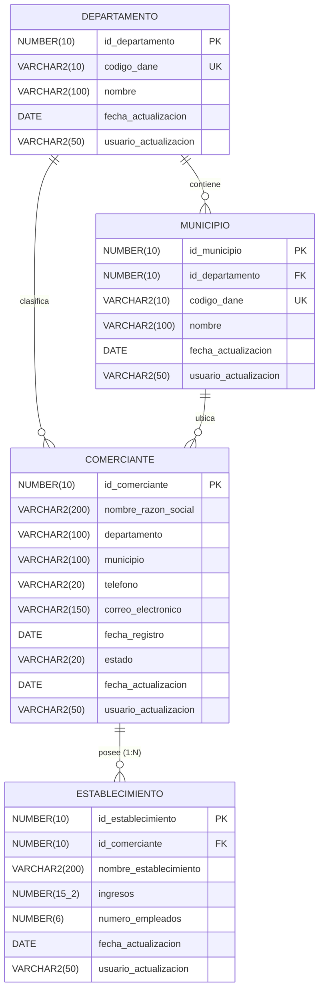

# MODELO ENTIDAD-RELACIÓN (MER) - RETO 01
## Evaluación PL/SQL Fullstack - Agremiación Nacional de Comercio

Este documento detalla el diseño y normalización de la base de datos relacional para el sistema de gestión de comerciantes y sus establecimientos.

---

### 1. Diagrama Entidad - Relación (Mermaid)

---

### 2. Diccionario de Datos

#### 2.1. Tabla `COMERCIANTE`
| Campo | Tipo de Dato | Nulo | Restricción | Descripción |
|---|---|---|---|---|
| `ID_COMERCIANTE` | NUMBER(10) | NO | PK, SEQ_COMERCIANTE | Identificador único del comerciante |
| `NOMBRE_RAZON_SOCIAL` | VARCHAR2(200) | NO | - | Nombre legal o razón social del comerciante |
| `DEPARTAMENTO` | VARCHAR2(100) | NO | - | Departamento de ubicación del comerciante |
| `MUNICIPIO` | VARCHAR2(100) | NO | - | Municipio/Ciudad de ubicación |
| `TELEFONO` | VARCHAR2(20) | SI | - | Teléfono de contacto (Opcional) |
| `CORREO_ELECTRONICO` | VARCHAR2(150) | SI | Formato email | Correo de contacto (Opcional) |
| `FECHA_REGISTRO` | DATE | NO | - | Fecha de formalización o registro mercantil |
| `ESTADO` | VARCHAR2(20) | NO | CHECK (Registrado, Activo, Inactivo, Suspendido, Cancelado) | Estado del comerciante |
| `FECHA_ACTUALIZACION` | DATE | NO | Default SYSDATE | Fecha de auditoría (gestionada por trigger) |
| `USUARIO_ACTUALIZACION`| VARCHAR2(50) | NO | Default USER | Usuario que realizó la última modificación |

#### 2.2. Tabla `ESTABLECIMIENTO`
| Campo | Tipo de Dato | Nulo | Restricción | Descripción |
|---|---|---|---|---|
| `ID_ESTABLECIMIENTO` | NUMBER(10) | NO | PK, SEQ_ESTABLECIMIENTO | Identificador único del establecimiento |
| `ID_COMERCIANTE` | NUMBER(10) | NO | FK -> COMERCIANTE (CASCADE) | Relación obligatoria con su propietario comerciante |
| `NOMBRE_ESTABLECIMIENTO` | VARCHAR2(200) | NO | - | Nombre comercial del local/establecimiento |
| `INGRESOS` | NUMBER(15,2) | NO | CHECK (>= 0), Default 0.00 | Ingresos brutos/operacionales (dos decimales) |
| `NUMERO_EMPLEADOS` | NUMBER(6) | NO | CHECK (>= 0), Default 0 | Total de trabajadores vinculados |
| `FECHA_ACTUALIZACION` | DATE | NO | Default SYSDATE | Auditoría gestionada por trigger |
| `USUARIO_ACTUALIZACION`| VARCHAR2(50) | NO | Default USER | Auditoría gestionada por trigger |

#### 2.3. Tablas de Normalización: `DEPARTAMENTO` y `MUNICIPIO`
Permiten optimizar el Reto 07 (Listas de valores con caché en memoria) y la carga en cascada del frontend (Reto 14).

---

### 3. Justificación de Normalización y Buenas Prácticas
1. **Primera Forma Normal (1FN):** Todos los atributos son atómicos; no existen grupos repetitivos.
2. **Segunda Forma Normal (2FN):** No existen dependencias parciales; las claves compuestas no aplican ya que se usan llaves subrogadas (`NUMBER`) generadas por secuencias.
3. **Tercera Forma Normal (3FN):** Los totales de activos e ingresos no se almacenan como columnas estáticas en la tabla `COMERCIANTE`, sino que se calculan dinámicamente mediante funciones de agregación (`SUM`, `COUNT`) en el paquete `PKG_COMERCIANTES`, garantizando consistencia y cero redundancia.
4. **Integridad Referencial:** Clave foránea `FK_ESTABLECIMIENTO_COM` con eliminación en cascada (`ON DELETE CASCADE`) para preservar consistencia al borrar un comerciante.
5. **Índices Estratégicos:** Se crearon índices funcionales `UPPER()` sobre `NOMBRE_RAZON_SOCIAL` y `MUNICIPIO`, e índices sobre `FECHA_REGISTRO` y `ESTADO` para acelerar los filtros requeridos en el Reto 04 y las consultas paginadas.
